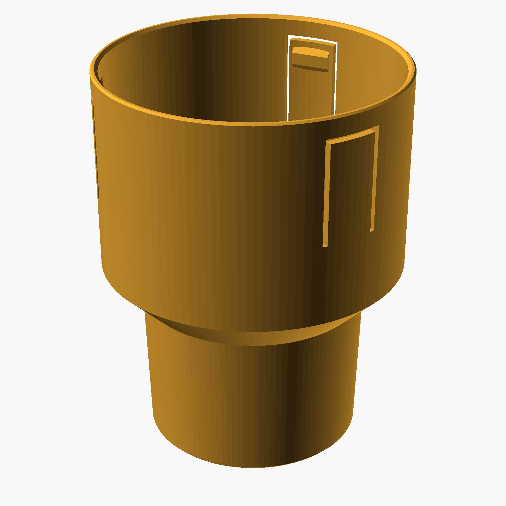
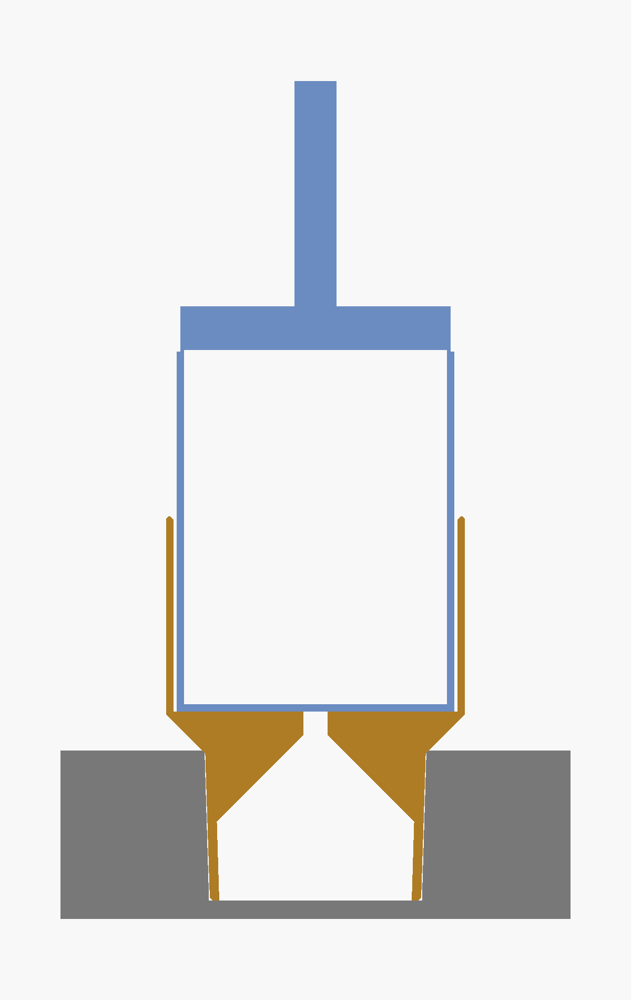
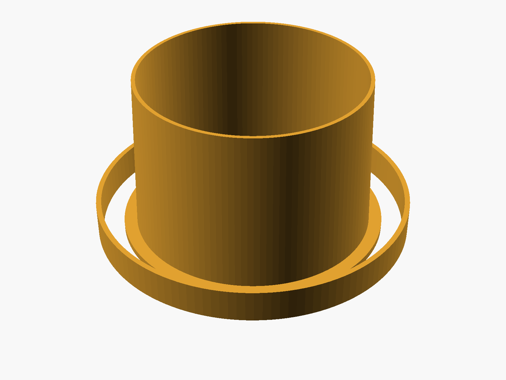

# Polo AW cup holder for the Nespresso Travel Tumbler

A 3D-printable cup holder adapter for the **VW Polo 6 (AW / 2G), pre-facelift 2017–2021**. It holds the **Nespresso Travel Tumbler "Samra Origins" (540 ml)**.

The tumbler body is 92.7 mm wide, which is too big for the Polo's centre-console cup holders. This adapter plugs into one of those holders and gives the tumbler a wide, deep cup. Three spring tabs grip the tumbler so it doesn't rattle.



| Cross-section in the car | Fit-test print |
|---|---|
|  |  |

Section legend: grey is the car's cup holder (schematic), orange is the adapter, blue is the tumbler.

## Files

| File | What it is |
|---|---|
| `polo_aw_nespresso_cupholder.scad` | Parametric OpenSCAD source. All sizes can be changed in the Customizer. |
| `stl/cupholder_polo_aw_nespresso.stl` | The adapter at the default sizes |
| `stl/fit_test.stl` | Quick gauges (about 40 min, about 25 g) to check both diameters before the full print |
| `build.sh` | Regenerates the STLs from the `.scad` file |

## Dimensions used

| | Value | Source |
|---|---|---|
| Tumbler body diameter | **92.7 mm** | Nespresso spec (Ø 9.27 cm; other pages round it to 9.3 cm) |
| Tumbler body height (no lid) | **~120 mm** | Nespresso spec (11.9–12.2 cm open, 21 cm with lid and straw) |
| Polo AW cup holder | **Ø 74 mm top, Ø 71 mm bottom, 50 mm deep** | **Estimate. Please measure yours.** VW doesn't publish this. |

At the defaults the adapter is Ø 99.5 mm × 128 mm. It stands 79 mm above the console, and the cup holds the bottom 65 mm of the tumbler.

## ⚠️ Before printing: measure two things

I couldn't find a published size for the Polo AW cup holder, and nobody can verify it for me remotely. **Measure it** with calipers or a ruler:

1. **Car cup holder:** inside diameter at the rim, inside diameter at the floor, and depth from the rim to the floor. If there's a rubber mat in the bottom, measure with it in place. If the holder isn't perfectly round, use the smallest width.
2. **Your tumbler:** body diameter at the very bottom and just below the lid. If the silicone band sits within the bottom 65 mm, measure over the band.

Then enter the numbers in the Customizer (see below). If they already match the table above, the ready-made STL works as is.

## Recommended workflow

1. **Print `fit_test`** (about 40 min, about 25 g). It is two separate pieces printed on the same plate:
   - The **inner piece** is a hollow copy of the plug. Push it into the car's cup holder: it should go all the way in and be snug, with no wobble.
   - The **outer ring** has the same diameter as the bottom of the cup. Slide it over the base of the tumbler: you want about 1 mm of play all round. The spring tabs take up that play in the real part.
2. Adjust the values if needed (see the tuning table) and print the fit test again if the change was big.
3. **Print the holder.**

## Print settings

| Setting | Value |
|---|---|
| **Material** | **PETG** (good) or **ASA/ABS** (best). **Not PLA.** A parked car in summer goes well over 60 °C and PLA will sag. |
| Orientation | As exported: plug on the bed, cup facing up. **No supports needed.** All overhangs are at 45°. |
| Layer height | 0.2 mm |
| Walls / perimeters | 4 (the cup wall is 2.4 mm, so it prints solid) |
| Top/bottom layers | 5 |
| Infill | 15–20 % gyroid |
| Brim | Optional. Use 5 mm for ASA/ABS to stop warping. |
| Estimate | About 120–150 g, about 4–7 h depending on the printer |

## Customizing (OpenSCAD)

1. Install [OpenSCAD](https://openscad.org/downloads.html) (free).
2. Open `polo_aw_nespresso_cupholder.scad`, then choose **Window → Customizer**.
3. Change the values, press **F6** to render, then **F7** to export the STL.
4. Set `part` to `fit_test` to export the gauges.

You can also upload the `.scad` file to MakerWorld's *Parametric Model Maker* and do the same in the browser.

Or from the command line:

```sh
openscad -o holder.stl  -D car_hole_top_d=75.5 -D car_hole_bottom_d=72 polo_aw_nespresso_cupholder.scad
openscad -o fit_test.stl -D 'part="fit_test"' -D car_hole_top_d=75.5 polo_aw_nespresso_cupholder.scad
```

### Tuning table

| Problem | Change |
|---|---|
| Plug wobbles in the car holder | Lower `plug_clearance` (it can go negative), or wrap the plug in 1 mm felt tape |
| Plug won't go all the way in | Raise `plug_clearance`, or check `car_hole_bottom_d` |
| Tumbler rattles | Raise `tab_bump` (for example 2.5) |
| Tumbler is hard to put in | Lower `tab_bump`, or raise `cup_clearance` |
| The wide cup hits the trim around the holder | Raise `cup_lift` (for example 5–10 mm) |
| The cup gets in the way of the gear lever or handbrake | Set `cup_offset` (for example 8 mm) and `cup_offset_angle` to move the cup away from it |
| Tumbler tips in hard corners | Raise `cup_depth` (for example 75–80) |
| Your tumbler turns out to be tapered | Set `tumbler_bottom_d` lower than `tumbler_top_d`. The cup follows the taper. |

## Design notes

- **Plug:** tapered to match the car's holder, so it wedges in snugly. It is hollow from below (3.2 mm wall, 45° roof) to save filament, and it stops 1 mm short of the holder floor.
- **Transition:** a 45° cone from the plug out to the cup, so it prints without supports.
- **Cup:** 2.4 mm wall with a lead-in chamfer on the rim. It has 3 U-cut **spring tabs** (16 × 32 mm) with a 2 mm wedge bump near the top. The bumps press on the tumbler with about 3–4 N each, which centres it and keeps it quiet over bumps. The tabs also absorb about ±1 mm of size variation.
- **Drain hole:** Ø 8 mm in the floor. The tumbler is meant for iced coffee, so condensation runs into the car's holder instead of pooling under the tumbler.

## Sources

- Nespresso, Travel Tumbler Samra (540 ml, "21 cm, Ø 9,3 cm", Tritan body and lid): <https://www.nespresso.com/bh/en/accessories/travel-tumbler-samra-yellow>
- Nespresso India, Travel Tumbler (H closed 21 cm, H open without lid 11.9 cm, Ø 9.3 cm): <https://www.nespresso.com/in/en/accessories/travel-tumbler>
- Nespresso South Africa lists Ø 9.27 cm, H 12.2 cm without the cap: <https://www.nespresso.com/sa/en/accessories/nomad-tumbler>
